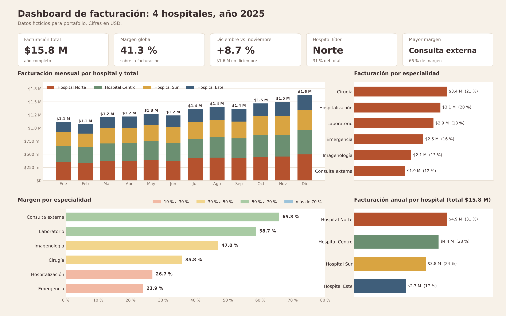

# Caso 1: Estandarización de tarifarios

## Resumen

Unificación de 4 tarifarios con servicios en común en una sola matriz que cruza costos, márgenes, precios de mercado y desviaciones, y definición de los protocolos de la posición de Pricing en una institución de salud en Ecuador.

**Resultado**

- La facturación aumentó aproximadamente 20 %.
- Se pudo facturar y prestar el servicio en cualquier sede habilitada.
- Se corrigieron los valores de unos 500 servicios, de una matriz de cerca de 2000.

## El problema

Se manejaban 4 tarifarios independientes que compartían varios servicios similares. Los precios estaban desactualizados y un mismo servicio costaba distinto según la sede, así que los pacientes iban a facturar a la sede donde salía más barato.

## Qué construí

Una matriz única que reemplazó los 4 tarifarios. Cada servicio aparece una sola vez, con su costo, su margen, el precio de mercado y la desviación entre ambos.

| Componente de la matriz | Qué permite ver |
| --- | --- |
| Costo del servicio | Base para calcular el margen |
| Margen | Rentabilidad por servicio |
| Pricing del mercado | Referencia externa de comparación |
| Desviación | Dónde el precio se aleja del mercado o del margen esperado |

Se unificaron los servicios de los 4 tarifarios en una sola base: la matriz final cubrió aproximadamente 2000 servicios. Con el criterio de Pareto del 80 % se corrigieron los valores de unos 500 servicios y se calculó su costo adecuado para seguir su margen. La matriz se compartía con la alta gerencia y el departamento de finanzas.

## Protocolos de Pricing

Flujo establecido para la posición de Pricing, desde el costeo de un servicio nuevo hasta su activación y seguimiento.

1. **Costeo e investigación de mercado, en paralelo.** Pricing trabajaba con finanzas en el costo del servicio mientras investigaba su precio de mercado.
2. **Aprobación en dos niveles.** Primero el subdirector técnico y el gerente del hospital; después la gerencia de marketing y finanzas.
3. **Creación y activación.** Con todas las aprobaciones, el servicio se creaba en los sistemas y se activaba.
4. **Seguimiento del margen.** Cada servicio se monitoreaba en la matriz compartida con la alta gerencia y finanzas.

## Herramientas y metodología

- **Excel:** costeo y matriz de precios por servicio, con costos, márgenes, precio de mercado y desviaciones.
- **Power BI:** matriz interactiva conectada a la facturación del hospital, que permitía dar seguimiento al margen y compartir la información con la alta gerencia y finanzas.

**Metodología**

1. **Consolidación.** Los servicios de los 4 tarifarios se reunieron en una sola base, con un registro por servicio.
2. **Comparación costo-mercado.** Para cada servicio se cruzaron costo, margen, precio de mercado y desviación.
3. **Priorización con Pareto 80 %.** Se atendieron primero los ~500 servicios de mayor peso.
4. **Corrección del valor.** Se ajustó el precio y se obtuvo el costo adecuado para seguir el margen de cada servicio.
5. **Seguimiento.** El margen se monitoreaba en Power BI, conectado a la facturación.

## Resultados

| Indicador | Valor |
| --- | --- |
| Tarifarios unificados | 4 → 1 |
| Servicios cubiertos por la matriz | ~2000 |
| Servicios con valor corregido (Pareto 80 %) | ~500 |
| Eficiencia operativa | Facturación y servicio disponibles en cualquier sede habilitada |
| Aumento de la facturación | ~20 % |

## Material de ejemplo

Todo el material de esta sección usa **datos ficticios por temas de confidencialidad hacia la entidad** (40 servicios inventados). Recrea el método, no cifras reales.

### Dashboard de facturación

Muestra la facturación mensual de los 4 hospitales y el total, la facturación y el margen por especialidad, la facturación anual por hospital y 5 KPIs: facturación total, margen global, variación de diciembre contra noviembre, hospital líder y especialidad con mayor margen.

### Archivo de la matriz

[`matriz_demo.xlsx`](matriz_demo.xlsx) contiene 4 hojas, todas con fórmulas:

| Hoja | Contenido |
| --- | --- |
| `Leeme` | Qué es el archivo, supuestos y código de colores |
| `Antes_4_tarifarios` | El mismo servicio en 4 tarifarios, con precio máximo, mínimo y diferencia |
| `Matriz_unificada` | Un registro por servicio: costo, precio, precio de mercado, margen, desviación, clase Pareto y estado de alerta |
| `Resumen` | Indicadores calculados sobre la matriz |
